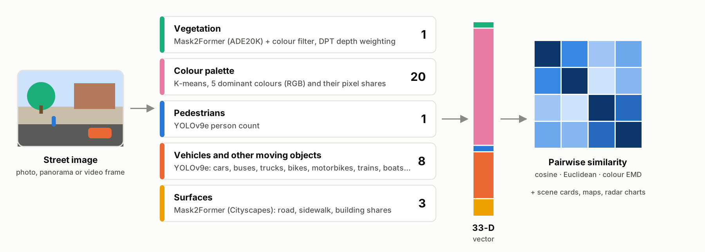

# simcitynet

[](https://github.com/hpa-code/simcitynet/actions/workflows/ci.yml)
[](https://hpa-code.github.io/simcitynet/)
[](https://pypi.org/project/simcitynet/)
[](https://pypi.org/project/simcitynet/)
[](LICENSE)
[](https://doi.org/10.2139/ssrn.5369073)

**Interpretable scene embeddings for street-level images.** `simcitynet` turns any street
photo, panorama or video frame into a 33-dimensional vector whose every number means something
— how green the street is, its five dominant colours, how many people and vehicles are visible,
and how much of the view is road, sidewalk and building — and compares images through those
vectors.

It implements the SimCityNet embedding from
[Caliskan, Iskakov, Li, McCollum and Ren (2025)](https://doi.org/10.2139/ssrn.5369073), which
was used to audit how text-to-video models (OpenAI Sora, Kuaishou Kling) depict cities in Europe
and the Middle East against 312,533 Google Street View photographs.



**Who it is for:** researchers in urban analytics, computational social science and AI
auditing who need image features they can explain, not only distances between opaque vectors.

## Installation

```bash
pip install "simcitynet[all]"     # full pipeline: PyTorch, Transformers and Ultralytics YOLO
pip install simcitynet            # core only: colour block, similarity and plots (no deep learning)
```

Until the first PyPI release, install from GitHub:
`pip install "simcitynet[all] @ git+https://github.com/hpa-code/simcitynet.git"`.

Python 3.10 or newer. A GPU is recommended for large batches; everything also runs on CPU.
Model weights (about 3 GB) download automatically on first use. Check your setup with
`simcitynet doctor`.

## Quick start

```python
from simcitynet import SimCityNet

scn = SimCityNet()                                 # models load on first use
emb = scn.embed(["zurich.jpg", "doha.jpg", "dublin.jpg"])

emb.raw                      # (3, 33) table: vegetation, color1_r … building_share
emb.similarity()             # pairwise cosine similarity (paper's batch normalisation)
emb.distance("color_emd")    # Earth Mover's distance between colour palettes

emb.plot.scene_card("zurich")   # overlays, palette and key numbers for one image
emb.plot.heatmap()              # similarity matrix with thumbnails
emb.plot.map()                  # images placed by similarity
```

No photos at hand? `simcitynet.datasets.fetch_examples()` downloads six openly licensed street
scenes from Wikimedia Commons (Amsterdam, Dublin, Zürich, Doha, Dubai, Tel Aviv) with their
credits.

From the command line:

```bash
simcitynet embed photos/ clip.mp4 -o embeddings.csv     # images, folders and videos
simcitynet similarity embeddings.csv -o similarity.csv
simcitynet card photos/zurich.jpg -o zurich_card.png
simcitynet features                                     # list the 33 dimensions
```

## Tutorials

| Notebook | What you will see | |
| --- | --- | --- |
| [1. Quick start](docs/tutorials/01_quickstart.ipynb) | Three cities, scene cards, a similarity heatmap | [](https://colab.research.google.com/github/hpa-code/simcitynet/blob/main/docs/tutorials/01_quickstart.ipynb) |
| [2. Europe vs the Middle East](docs/tutorials/02_europe_vs_middle_east.ipynb) | A small version of the paper's comparison | [](https://colab.research.google.com/github/hpa-code/simcitynet/blob/main/docs/tutorials/02_europe_vs_middle_east.ipynb) |
| [3. Video frames](docs/tutorials/03_video_frames.ipynb) | Embedding a clip frame by frame, comparing it with photos | [](https://colab.research.google.com/github/hpa-code/simcitynet/blob/main/docs/tutorials/03_video_frames.ipynb) |
| [4. Customising](docs/tutorials/04_customising.ipynb) | CPU-only colour mode, settings, your own models, saving results | [](https://colab.research.google.com/github/hpa-code/simcitynet/blob/main/docs/tutorials/04_customising.ipynb) |

Full documentation: **<https://hpa-code.github.io/simcitynet/>**

## The 33 dimensions

| Block | Dims | Meaning | Model |
| --- | --- | --- | --- |
| Vegetation | 1 | Depth-weighted Green View Index over trees, grass and plants | Mask2Former (ADE20K) + DPT depth |
| Colour | 20 | Five dominant RGB colours (15) and their pixel shares (5), largest first | K-means, k = 5 |
| Pedestrians | 1 | People detected | YOLOv9e |
| Vehicles | 8 | Bicycles, cars, motorcycles, airplanes, buses, trains, trucks, boats | YOLOv9e |
| Surfaces | 3 | Share of pixels that are road, sidewalk and building | Mask2Former (Cityscapes) |

Where the paper leaves a detail open (e.g. the detection threshold or the order of the K-means
colours), the package uses a documented default; see
[Faithfulness to the paper](https://hpa-code.github.io/simcitynet/faithfulness/).

## How it compares

General-purpose embeddings (CLIP, DINOv2, ResNet features) capture far more visual detail but
their dimensions have no direct meaning. Street-view toolkits typically report a single
measure such as the Green View Index, or rely on extra GIS/POI data (e.g. Urban2Vec).
SimCityNet sits in between: a compact, image-only, fully interpretable vector designed for
comparing synthetic and real scenes.

## Reproducibility

Every result records the package version, model IDs, settings, device and library versions
(`emb.provenance`, saved as JSON next to the CSV). The PyPI package ships no model weights;
they are downloaded from their original publishers. See [MODEL_LICENSES.md](MODEL_LICENSES.md)
before commercial use — in particular, Ultralytics YOLO is AGPL-3.0 and the segmentation models
are trained on datasets with their own terms.

## Citation

If you use `simcitynet`, please cite the paper (GitHub's **Cite this repository** button gives
BibTeX and APA from [CITATION.cff](CITATION.cff)):

```bibtex
@article{caliskan2025simcitynet,
  title   = {SimCityNet: Quantifying Geo-Cultural Bias in AI-Generated Urban Videos
             through Interpretable Scene Embeddings},
  author  = {Caliskan, Cantay and Iskakov, Abylay and Li, Yuanzhu and McCollum, Brendan and Ren, Yi},
  journal = {SSRN Electronic Journal},
  year    = {2025},
  doi     = {10.2139/ssrn.5369073}
}
```

## Contributing

Bug reports, questions and pull requests are welcome — see [CONTRIBUTING.md](CONTRIBUTING.md)
and our [Code of Conduct](CODE_OF_CONDUCT.md).

## License

The package code is released under the [MIT License](LICENSE). Third-party models keep their
own licences; see [MODEL_LICENSES.md](MODEL_LICENSES.md).
