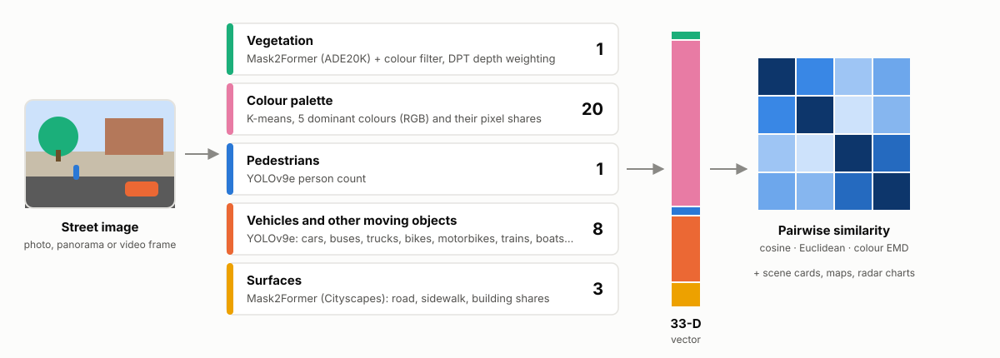

---
hide:
  - navigation
---

# simcitynet

<div class="hero" markdown>

<p class="tagline">
<strong>Interpretable scene embeddings for street-level images.</strong>
Turn any street photo, panorama or video frame into 33 numbers that each mean something —
greenery, dominant colours, people, vehicles, road, sidewalk and building — and compare
images through them.
</p>



</div>

`simcitynet` implements the embedding introduced in
[*SimCityNet: Quantifying Geo-Cultural Bias in AI-Generated Urban Videos through Interpretable
Scene Embeddings*](https://doi.org/10.2139/ssrn.5369073) (Caliskan, Iskakov, Li, McCollum and
Ren, 2025). The paper used it to compare more than 297,000 frames generated by OpenAI Sora and
Kuaishou Kling with 312,533 Google Street View photographs from 110 districts in Europe and the
Middle East.

<div class="grid cards" markdown>

-   :material-rocket-launch: **Get started**

    ---

    Install with `pip install "simcitynet[all]"` and embed your first images in five lines.

    [:octicons-arrow-right-24: Quick start](quickstart.md)

-   :material-shape: **The 33 dimensions**

    ---

    What each number measures, how it is computed and how images are compared.

    [:octicons-arrow-right-24: Concepts](concepts.md)

-   :material-notebook: **Tutorials**

    ---

    Four notebooks you can open in Google Colab, from three cities to video frames.

    [:octicons-arrow-right-24: Tutorials](tutorials/01_quickstart.ipynb)

-   :material-scale-balance: **Research use**

    ---

    Every choice the paper left open, the limitations of the models, and how to cite.

    [:octicons-arrow-right-24: Faithfulness to the paper](faithfulness.md)

</div>

## Five lines

```python
from simcitynet import SimCityNet

emb = SimCityNet().embed(["zurich.jpg", "doha.jpg", "dublin.jpg"])
emb.similarity()                # pairwise cosine similarity
emb.plot.scene_card("zurich")   # what SimCityNet sees in one image
emb.plot.heatmap()              # how all images relate
```

## Why interpretable?

General-purpose image embeddings (CLIP, DINOv2) capture far more visual detail, but when two
images are far apart they cannot tell you *why*. In SimCityNet a difference is always
readable: one image has twice the greenery, another has no pedestrians, a third has a narrower
colour palette. That is what makes it useful for auditing generative models and for urban
research that has to explain its measurements.
